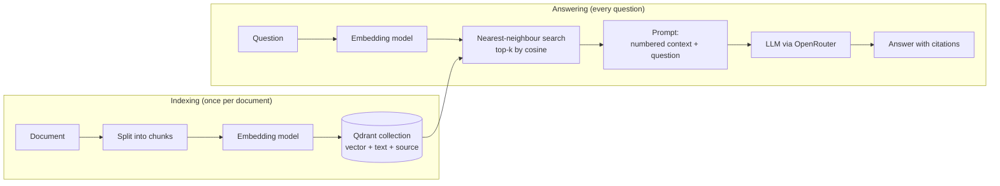
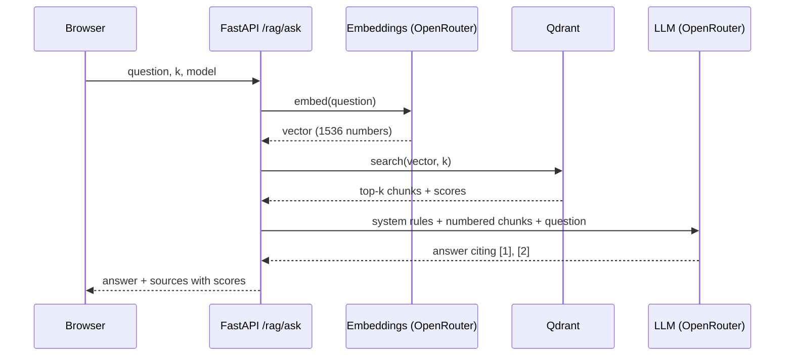
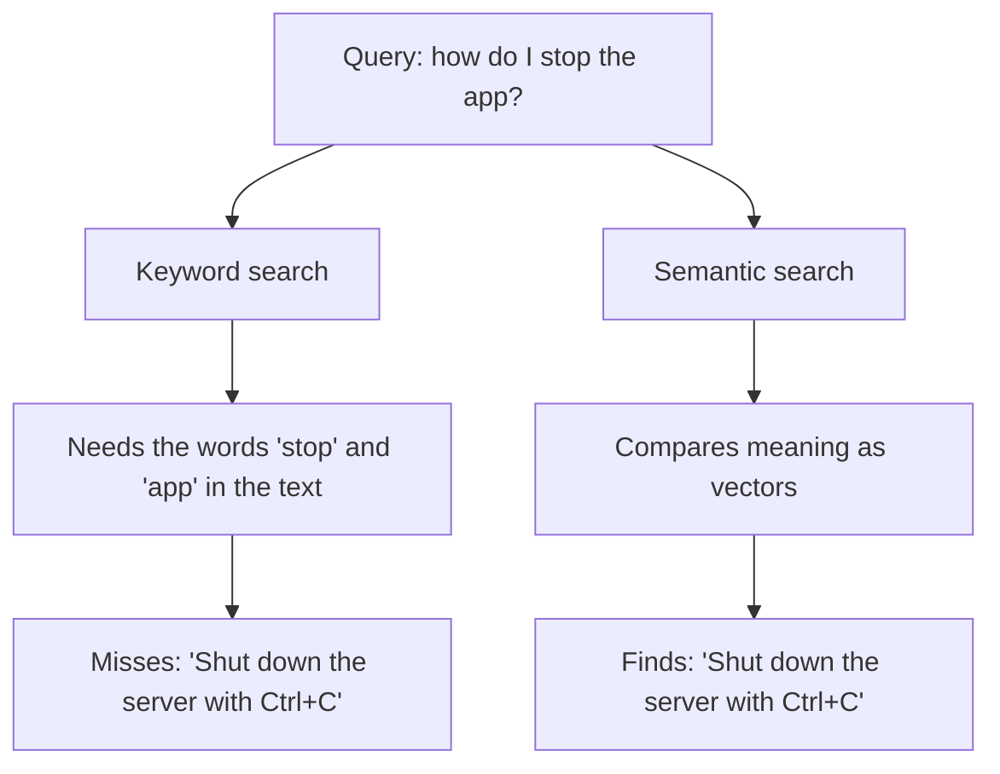
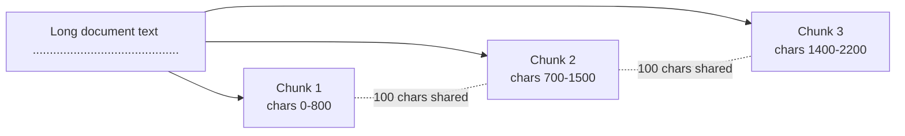
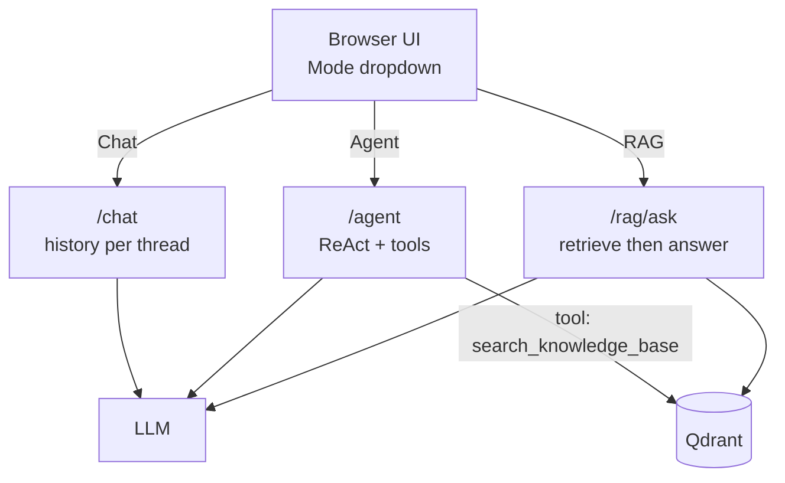

# Chapter 5: RAG with Qdrant

## Goal
Let the model answer from your own documents instead of only from what it was trained on. This is Retrieval-Augmented Generation (RAG), using Qdrant as the vector database.

## How RAG works
```
Indexing (once per document)
  document -> split into chunks -> embed each chunk -> store vectors + text in Qdrant

Answering (per question)
  question -> embed -> find the nearest chunks in Qdrant -> put them in the prompt -> LLM answers with citations
```
Embeddings turn text into vectors so that texts with similar meaning are close together. Searching by vector finds relevant passages even when the words differ.

## Diagrams

### 1. The whole pipeline

The same embedding model must be used on both sides.

### 2. What happens on `POST /rag/ask`


### 3. Keyword search vs semantic search


### 4. Cosine similarity: it is the angle that matters
```
        B (similar meaning)
         \  small angle      cos ≈ 0.9  -> very similar
          \
           \ _______________ A (the query)
           /
          /  90 degrees      cos = 0    -> unrelated
         /
        C (unrelated)

 Opposite directions (180 degrees)       cos = -1   -> opposite meaning
```
Vector length does not change the result, only direction does. In the UI glossary there is a slider that shows this live.

### 5. Chunking with overlap

The overlap keeps a sentence that falls on a boundary available in at least one chunk.

### 6. Where RAG fits in the app

RAG can be a fixed pipeline (`/rag/ask`: always retrieve) or a tool the agent decides to use (`search_knowledge_base`).

## Important terms: vector search
| Term | Meaning |
|---|---|
| **Embedding** | A list of numbers (here 1536) that represents the meaning of a piece of text. Produced by an embedding model, not by the chat LLM. |
| **Vector** | That list of numbers, viewed as a point or arrow in a high-dimensional space. |
| **Dimension** | The length of the vector. It is fixed by the embedding model and must match the Qdrant collection (`VECTOR_SIZE`). |
| **Semantic search** | Searching by meaning instead of exact words. "How do I stop the app?" can match a passage about "shutting down the server". Opposite of keyword search. |
| **Keyword search (lexical, BM25)** | Matches the actual words. Good for names, ids and exact terms; misses synonyms. Often combined with vector search as **hybrid search**. |
| **Similarity metric** | The formula for "how close" two vectors are. Must be chosen when creating the collection. |
| **Cosine similarity** | Compares the angle between two vectors, ignoring their length. Ranges from -1 to 1; closer to 1 means more similar in meaning. Our collection uses cosine, and it is the usual choice for text. |
| **Cosine distance** | `1 - cosine similarity`. Smaller is closer. |
| **Dot product** | Multiplies matching numbers and adds them up. Equals cosine similarity when vectors are normalised to length 1 (OpenAI embeddings are). |
| **Euclidean distance** | Straight-line distance between two points. Sensitive to vector length. |
| **Score** | The similarity Qdrant returns for each hit. Only compare scores from the same query and model; there is no universal "good" value. |
| **Top-k** | How many nearest chunks to return (`k` in `/rag/ask`). Too low can miss the answer; too high adds noise and cost. |
| **Nearest-neighbour search (kNN)** | Finding the k vectors closest to the query vector. |
| **ANN / HNSW** | Approximate nearest-neighbour search. Qdrant uses an HNSW graph index to avoid comparing against every vector, trading a tiny bit of accuracy for large speed gains. |
| **Chunk** | A slice of a document that is embedded and stored as one point. Size and overlap affect retrieval quality. |
| **Chunk overlap** | Characters repeated between neighbouring chunks so a sentence cut at a boundary is still found. |
| **Collection** | Qdrant's equivalent of a table: a set of vectors with the same size and metric. |
| **Point** | One stored record in a collection: id + vector + payload. |
| **Payload** | The JSON data stored next to a vector (the chunk text and `metadata.source`). Can be used to filter results. |
| **Payload index** | An index on a payload field so filtering and deleting by it is fast (we index `metadata.source`). |
| **Re-ranking** | A second, slower model that reorders the top hits for better precision. Not used yet. |
| **Grounding / hallucination** | Grounding means the answer is based on retrieved text. A hallucination is a confident answer that is not supported by it. |

Things worth remembering:
- Always use the **same embedding model** for indexing and querying. Vectors from different models are not comparable.
- Changing the embedding model, its dimension or the metric means creating a **new collection** and re-indexing.
- Semantic search finds *similar meaning*, not *true answers*. It can return related but irrelevant text, which is why the prompt says to answer "I don't know" when the context lacks the answer.
- A low score on every hit usually means the knowledge base does not contain the answer.

## What we did
1. **Embeddings through OpenRouter** (`rag.py`): `OpenAIEmbeddings` with `base_url` set to OpenRouter and model `openai/text-embedding-3-small` (1536 dimensions). No extra provider or key is needed. `RAG_EMBEDDING_MODEL` can override it; if you change it, change `VECTOR_SIZE` to match and use a new collection.
2. **Qdrant vector store**: `QdrantVectorStore` from `langchain-qdrant`. The collection is created on first use (cosine distance), plus a keyword index on `metadata.source` so chunks can be filtered and deleted by document.
3. **Ingestion**: `RecursiveCharacterTextSplitter` (800 characters, 100 overlap) splits the text. Chunk ids are deterministic, and re-indexing a source first deletes its old chunks, so it is safe to run repeatedly.
4. **Retrieval and generation** (`answer`): fetch the top-k chunks with scores, number them, and ask the model to answer using only those passages and cite them like `[1]`. If the context lacks the answer it must say it doesn't know. The passages are marked as untrusted data (a defensive prompt against injection through documents).
5. **API** (`app.py`):
   - `GET /rag/status` shows whether Qdrant is configured.
   - `POST /rag/ingest` takes `{source, text}`.
   - `POST /rag/ingest-docs` indexes the README and chapter notes.
   - `GET /rag/sources` lists indexed documents with chunk counts; `DELETE /rag/sources?source=...` removes one.
   - `POST /rag/ask` takes `{question, k, model, temperature}` and returns the answer plus the retrieved sources with scores.
6. **UI**: the old Agent checkbox became a **Mode** dropdown (Chat, Agent, RAG). A collapsible **Knowledge base** panel can index the project notes, upload a `.txt`/`.md` file or paste text, list sources and delete them. In RAG mode the retrieved chunks appear above the answer, each with an animated score bar.
   - A **Vector search glossary** panel has an animated pipeline (Question, Embed, Vector search, Top-k, LLM, Answer), an interactive cosine-similarity slider, and clickable term cards that expand to a definition and example.
   - CSS animations (fade-in, glow, growing bars, hover lift) are switched off automatically for users who prefer reduced motion.
7. **Agentic RAG**: when Qdrant is configured, the agent also gets a `search_knowledge_base` tool and can decide for itself when to look things up.
8. **Credentials**: `QDRANT_URL`, `QDRANT_API_KEY` (and optionally `QDRANT_COLLECTION`) live in `.env`; `.env.example` only has empty placeholders.

## Concepts covered
- Embeddings and vector similarity search
- Chunking: size and overlap trade-offs
- Vector databases (Qdrant), collections, payloads, payload indexes
- Grounded answers with citations, and "I don't know" when the context is missing
- Retrieval scores
- Prompt injection through retrieved text
- RAG as a fixed pipeline vs. retrieval as an agent tool

## Try it
```bash
# .env
QDRANT_URL=https://<your-cluster>.cloud.qdrant.io:6333
QDRANT_API_KEY=<your key>

uv run uvicorn app:app --reload
```
In the UI: open **Knowledge base**, click **Index project notes**, switch Mode to **RAG**, and ask:
- `How does memory work in chapter 4 and what are its limits?`
- `Which tools does the chapter 3 agent have?`
- `Who won the 1998 football world cup?` (not in the documents, so it should say it doesn't know)

In Agent mode, ask `Using the knowledge base, which tools does the chapter 3 agent have?` and watch it call `search_knowledge_base`.

## Limits
- Retrieval quality depends on chunking and the embedding model; there is no re-ranking or hybrid (keyword + vector) search yet.
- RAG mode is stateless: each question is independent and has no chat memory.
- The agent only gets the knowledge-base tool if Qdrant is configured when the server starts.
- Uploaded text is read in the browser and limited to 500,000 characters. There is no PDF parsing.
- Anyone who can reach the API can add or delete documents. Add authentication before exposing it.

## Files
| File | Purpose |
|---|---|
| `rag.py` | Embeddings, Qdrant store, ingestion, search, answering |
| `agent.py` | `search_knowledge_base` tool |
| `app.py` | `/rag/*` endpoints, mode selector, knowledge-base panel |
| `.env.example` | Placeholders for the Qdrant settings |
