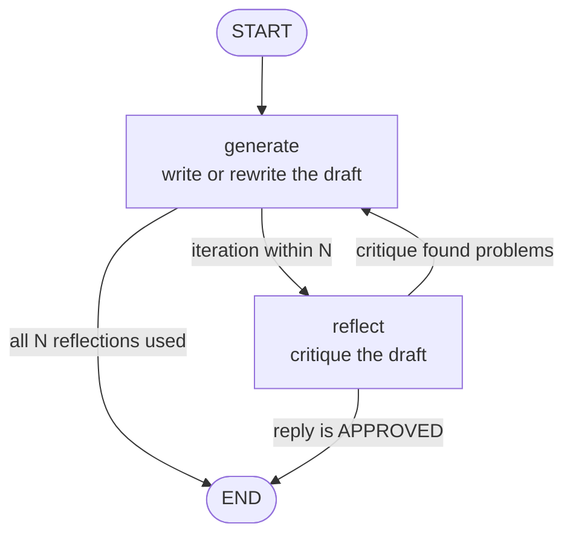
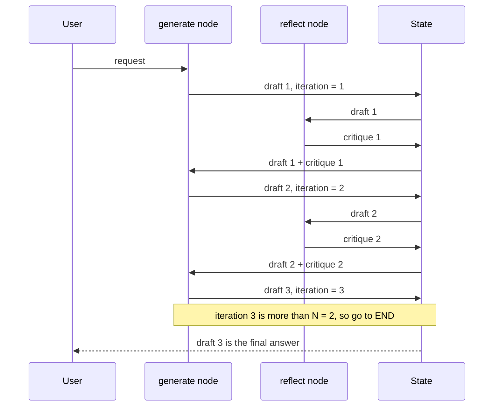
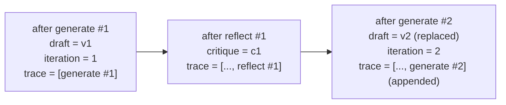
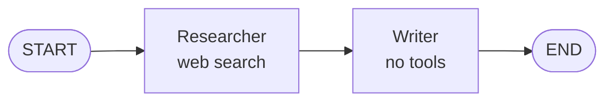
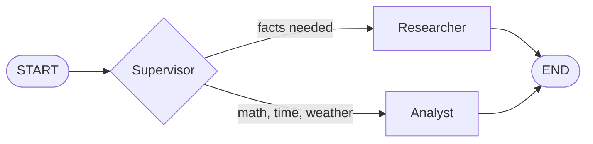
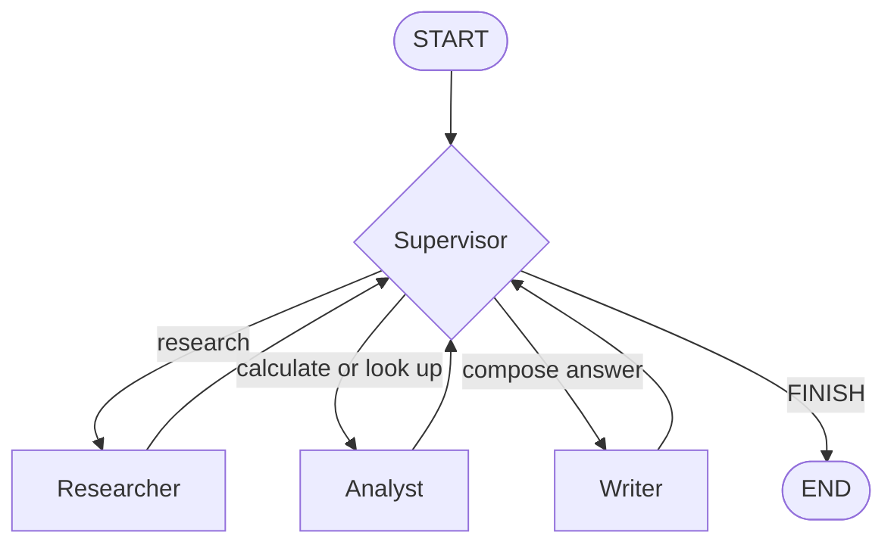
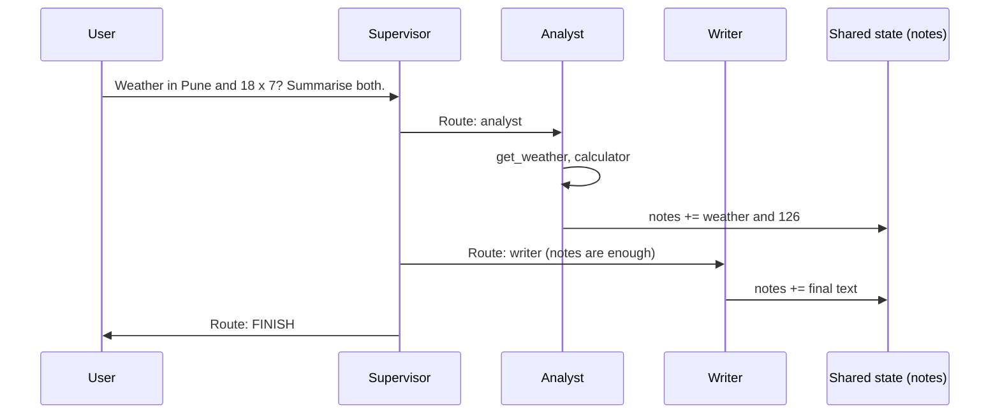
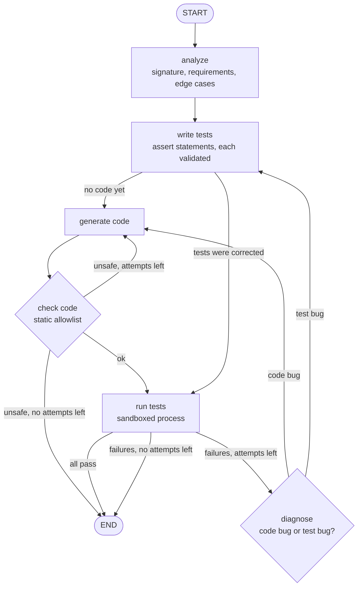

# Chapter 6: LangGraph and the Reflection pattern

## Goal
Learn LangGraph by building a graph ourselves instead of using the prebuilt `create_agent`. The example is **Basic Reflection**: one node writes a draft, another critiques it, and the critique is fed back to improve the draft.

## What, why, how
| | |
|---|---|
| **What** | A workflow where a *generate* LLM call writes a draft, a *reflect* LLM call reviews it (Critique, Merits, Recommendations), and the draft is rewritten using that review. Repeated N times, or until the reviewer replies `APPROVED`. |
| **Why** | Models are better at reviewing finished text than at avoiding every flaw in one shot. A critique loop raises quality for writing, code and plans, at the cost of more calls (time and tokens). |
| **How** | A LangGraph `StateGraph`: shared **state**, two **nodes**, and **conditional edges** that decide whether to loop or stop. |

## LangGraph in one page
| Concept | Meaning | In `reflection.py` |
|---|---|---|
| **State** | The shared data every node reads and updates (a `TypedDict`). | `State`: request, draft, critique, iteration, max_reflections, trace |
| **Node** | A function `state -> partial update`. LangGraph merges the update into the state. | `generate`, `reflect` |
| **Edge** | A fixed connection between nodes. | `START -> generate` |
| **Conditional edge** | A function that looks at the state and returns where to go next. | `after_generate`, `after_reflect` |
| **Reducer** | Says how updates to a field are combined. Without one, a new value replaces the old. | `trace: Annotated[list[str], operator.add]` appends |
| **START / END** | Special entry and exit points. | |
| **compile()** | Validates the graph and returns a runnable. | `build_graph()` |
| **stream** | Emits each node's update as it finishes. | `astream(..., stream_mode="updates")` |
| **config** | Per-run settings passed to every node (callbacks, model, temperature). | `RunnableConfig` with `configurable` |

`create_agent` from chapter 3 is just a prebuilt LangGraph graph (model node, tools node, loop). This chapter writes the graph by hand.

## The graph

This diagram matches the real compiled graph. The app also exposes the generated Mermaid text at `GET /reflect/graph` (`get_graph().draw_mermaid()`) and shows it in the UI.

### One run, step by step (N = 2)

N reflections produce N + 1 drafts. If the reviewer answers `APPROVED` earlier, the loop ends early.

### How state changes

`draft` and `critique` are overwritten each time; `trace` uses a reducer, so it only grows.

## What we did
1. **`reflection.py`**: the `State`, the `generate` and `reflect` nodes, the two routing functions, `build_graph()`, and `run_stream()` which yields one event per finished node.
2. **Routing**: `after_generate` stops when `iteration > max_reflections`. `after_reflect` stops when the critique starts with `APPROVED`. Both return labels that `add_conditional_edges` maps to node names or `END`.
3. **Prompts**: the generator rewrites using the critique; the reviewer must answer in a fixed format or reply exactly `APPROVED`.
4. **Config instead of globals**: model and temperature are passed per run through `config["configurable"]`, and callbacks go in `config` so `MonitoringHandler` (chapter 2) and LangSmith tracing (tag `chapter-6`) see every node's LLM call.
5. **API** (`app.py`):
   - `POST /reflect` takes `{message, max_reflections (1-5), model, temperature}` and streams NDJSON, one line per event: `draft`, `critique`, `final` or `error`.
   - `GET /reflect/graph` returns the graph as Mermaid text.
6. **UI**: Mode dropdown has a new **Reflection (LangGraph)** option plus a Reflections selector. A live panel appears with:
   - WHAT / WHY / HOW / LANGGRAPH cards explaining the pattern,
   - an animated graph: the active node pulses, the edge being followed is dashed and animated, an orange token travels along it, finished nodes turn green,
   - a caption that explains each step in words (for example which conditional edge fired and why),
   - a live view of the shared state, including the `trace` reducer growing.
   The animation is driven by the real stream events, not a fixed timer, and is turned off for users who prefer reduced motion.

## Multi-agent teams: 2, 3 and 4 agents
Reflection has two roles. This part scales the idea up: several agents, each with its own prompt and tools, cooperating through one shared state. Three examples, each with a different topology. Code: `multiagent.py`.

| Agents | Pattern | Who | Control flow |
|---|---|---|---|
| **2** | Pipeline | Researcher, Writer | Fixed edges: researcher then writer |
| **3** | Router | Supervisor, Researcher, Analyst | Supervisor picks one specialist (conditional edge), who answers |
| **4** | Supervisor loop | Supervisor, Researcher, Analyst, Writer | Every worker returns to the supervisor, which picks the next step until `FINISH` |

The agents:
- **Researcher**: a `create_agent` with `web_search` (and `search_knowledge_base` when Qdrant is configured).
- **Analyst**: a `create_agent` with `calculator`, `current_time`, `get_weather`, `word_count`.
- **Writer**: a plain LLM call, no tools, that turns the team's notes into the final answer.
- **Supervisor**: an LLM call with *structured output*: a Pydantic `Route` model (`next` and `reason`), so its decision is a validated value that a conditional edge can follow.

### 2 agents: pipeline

Predictable and cheap. Use it when the steps are always the same.

### 3 agents: router

Use it when different questions need different tools. The supervisor decides once.

### 4 agents: supervisor loop

Use it when a question needs several skills in sequence. The supervisor can reuse or skip workers, and a step limit (`max_steps`, default 6) stops runaway loops.

### One 4-agent run

This is the real trace from a test run: the supervisor chose analyst, then writer, then FINISH.

### Shared state
```python
class MAState(TypedDict):
    question: str
    notes: Annotated[list[str], operator.add]   # every agent appends its findings
    log: Annotated[list[dict], operator.add]    # events shown in the UI
    next: str                                   # the supervisor's last decision
    steps: int
    max_steps: int
    answer: str
```
Agents do not talk to each other directly. They read the notes, do their part, and add to the notes. The reducers (`operator.add`) are what let several agents write to the same field safely.

### API and UI
- `POST /multi` takes `{message, kind: duo | trio | quartet, max_steps (2-8), model, temperature}` and streams one event per finished node (`update`, then `final`).
- `GET /multi/graph/{kind}` returns the compiled graph as Mermaid text.
- UI: **Mode: Multi-agent team (LangGraph)** and a **Team** selector (2, 3 or 4 agents). The panel shows WHAT/WHY/HOW cards for the chosen pattern, colour-coded agent chips, and an animated graph built for that team: the active agent pulses, a token travels along the edge being followed (including the loops back to the supervisor), finished agents turn green, and a caption explains each hand-off. The chat log shows every agent's tool calls, results and messages with a colour bar per agent.

Try:
- 2 agents: `What is LangGraph in one sentence?`
- 3 agents: `What is (123*45)+7?` (goes to the analyst) or `Who created LangChain?` (goes to the researcher)
- 4 agents: `What is the weather in Pune and what is 18 times 7? Summarise both.`

### Choosing a pattern
| | Pipeline | Router | Supervisor loop |
|---|---|---|---|
| LLM calls | fewest | few | most (one supervisor call per step) |
| Flexibility | none | pick one expert | any order, any number of steps |
| Predictability | high | medium | lower |
| Risk | rigid | wrong routing | loops, cost, a worker being skipped |

Start with the simplest pattern that works. More agents add latency, cost and failure modes; one well-prompted agent with tools is often enough.

## Flow engineering: code generation with tests
The idea (popularised by the AlphaCodium paper): instead of polishing one big prompt, **engineer the whole flow** around the model. Break the task into small steps, validate each step's output, and let an objective signal (test results) decide what happens next. Code: `flow.py` and `sandbox.py`.

| | Prompt engineering | Flow engineering |
|---|---|---|
| Unit of design | one prompt | a graph of steps |
| Output checking | you read it | validated between steps, tests decide |
| Failures | rewrite the prompt and hope | feed the error back and loop, within a budget |
| Who decides what is next | you | conditional edges on real signals |

### The flow


### Why each step exists
| Step | Job | Flow-engineering idea |
|---|---|---|
| **analyze** | Restate the task as a function name, signature, requirements and edge cases (Pydantic `Analysis`). | Make the model think about the problem before writing code. |
| **write tests** | Produce single-line `assert` statements. Each is parsed and must be exactly one `assert` that passes the safety check; invalid or duplicate ones are dropped. | Generate the checker first; validate model output before using it. |
| **generate code** | Write the solution, given the tests (and on retries: the old code, failures and diagnosis). | Small, focused prompt with exactly the context needed. |
| **check code** | Static allowlist check (see Safety). | A cheap deterministic gate before any execution. |
| **run tests** | Execute every test; failures include `got X, expected Y`. | An objective signal instead of the model's opinion. |
| **diagnose** | Decide `code_bug` or `test_bug` (Pydantic `Diagnosis`). | Tests are also LLM output and can be wrong; the flow can repair either side. |

`attempts` counts test runs and rejected code. Every loop passes through one of them, so the flow always ends within `max_attempts`.

### What the tests showed
- **Easy task** (IPv4 validation): analyze, 10 tests, code, all 10 pass on the first run.
- **Hard task** (Fibonacci mod 1,000,000,007 for n up to 10^6): the first version of the flow failed. One LLM-written test had a wrong expected value, so three rewrites of correct code kept failing the same test, and the diagnose step blamed the code each time. That is the classic weakness of test-driven flows. The fix was flow design, not a smarter model: tests may only contain values that can be checked by hand (property checks for big inputs), and `diagnose` is told to suspect a test that keeps failing identically after the code was rewritten. After that, the same task passed first time.

### Safety: running model-written code
Executing generated code is the risky part, so it is **off by default** and defended in layers. The flow endpoint returns 403 unless `FLOW_ALLOW_CODE_EXEC=true` is set in `.env`.
1. **Static allowlist** (`ast`): only `math, itertools, collections, re, functools, heapq, bisect, string, operator, statistics, decimal, fractions, typing, dataclasses` may be imported; no `eval, exec, open, input, getattr...`; no dunder attributes; no string literals containing `__` (blocks format-string tricks).
2. **Restricted runtime**: the code runs with a reduced set of builtins and a guarded `__import__`, so even if the static check were bypassed `import os` and `open()` fail.
3. **Separate process**: `python -I -S` in a temporary directory, with an empty environment (no API keys), CPU, memory, file-size and file-count limits, and a 5 second timeout.
4. **Result integrity**: results come back as JSON tagged with a random nonce so the solution cannot forge them by printing.

Verified by test: `import os`, `open('/etc/passwd')`, `eval`, `().__class__.__bases__`, `'{0.__class__}'.format`, `__import__` and `getattr` are all rejected; an infinite loop is killed by the timeout; infinite recursion and a 10^10 allocation fail cleanly.

> This is defence in depth for a learning project, **not a security boundary**. A determined attacker may find an escape from an in-process Python sandbox. For real untrusted code use containers, gVisor or Firecracker with no network, and never expose this endpoint publicly.

### API and UI
- `POST /flow` takes `{problem, max_attempts (1-5), model, temperature}` and streams one event per finished node, then a `final` event with `status`, `code`, `passed`, `total`. `GET /flow/status` says whether execution is enabled; `GET /flow/graph` returns the graph as Mermaid text.
- UI: **Mode: Flow engineering (code + tests)** and an **Attempts** selector. The animated graph shows every node and every loop, including the unsafe-code retry, the test-bug detour and the last-attempt exit; a caption explains each decision in words. Below it, the **tests** list updates live (pending, then ✓ or ✗ with `got X, expected Y`) and the **current code** is shown and replaced when a new version is generated.

Try:
- `Write a function that checks whether a string is a valid IPv4 address (four numbers 0-255 separated by dots, no leading zeros).`
- `Write a function that returns the n-th Fibonacci number modulo 1,000,000,007 for n up to 10**6.`
- With Attempts = 1 on a hard problem, watch the flow stop because the budget is used up.

## Concepts covered
- Flow engineering: validated steps, objective signals, bounded loops, repairing either code or tests
- Sandboxing generated code (and why it is only defence in depth)
- Writing a `StateGraph` by hand: state, nodes, edges, conditional edges, `compile()`
- Multi-agent patterns: pipeline, router, supervisor loop
- Structured output with Pydantic (`with_structured_output`) to make routing decisions reliable
- Agents as graph nodes (a `create_agent` called inside a node)
- Reducers (`Annotated[..., operator.add]`)
- Loops and stop conditions in a graph (max iterations and an early exit)
- Streaming node updates (`stream_mode="updates"`) to a browser as NDJSON
- Passing runtime config and callbacks through a graph
- Visualising a compiled graph with `draw_mermaid()`
- The Reflection pattern and its cost trade-off

## Try it
```bash
uv run uvicorn app:app --reload
```
In the UI choose **Mode: Reflection (LangGraph)**, pick the number of reflections, and send for example `Write a two-sentence product blurb for a reusable water bottle.` Watch the graph, the caption and the state panel.

```bash
curl -sN -X POST localhost:8000/reflect -H 'Content-Type: application/json' \
  -d '{"message":"Write a one-sentence slogan for a coffee shop.","max_reflections":1}'
```

## Limits
- Reflection costs `2N + 1` LLM calls, so latency and token use grow with N.
- The same model reviews its own work, so it can miss its own blind spots; a different or stronger reviewer model helps.
- Reviewers tend to always find something to criticise, so `APPROVED` is rare and N usually decides when to stop.
- A critique does not guarantee improvement; later drafts can be worse. Only the last draft is returned.
- The run is not saved: no checkpointer, so there is no pause, resume or replay yet.

## Ideas for next
Add a checkpointer and `interrupt` for human approval, give the reviewer tools (web search, RAG), use different models for generate and reflect, or build a plan, execute, review graph with subgraphs.

## Files
| File | Purpose |
|---|---|
| `reflection.py` | State, nodes, routing, compiled graph, streaming runner |
| `multiagent.py` | 2-, 3- and 4-agent graphs, supervisor with structured output, streaming runner |
| `flow.py` | Flow-engineering graph: analyze, tests, code, check, run, diagnose |
| `sandbox.py` | Static allowlist check and restricted subprocess runner for generated code |
| `app.py` | `/reflect`, `/multi` and `/flow` endpoints, Reflection, Multi-agent and Flow modes, animated panels |
